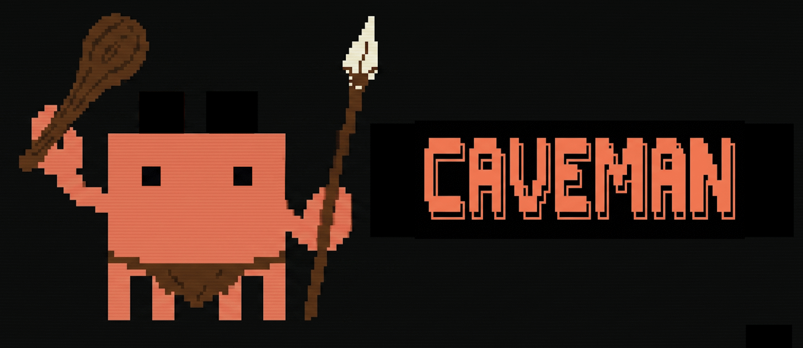

<p align="center">
  
</p>

<h1 align="center">Caveman Output Style for Claude Code</h1>

<p align="center">Better consistency and adherence than CLAUDE.md or skills. Always-on formatting. Less fluff, same technical signal.</p>

## quick start

One command. Done.

```bash
# macOS / Linux
mkdir -p ~/.claude/output-styles && cp ./.claude/output-styles/caveman.md ~/.claude/output-styles/caveman.md
```

```powershell
# Windows
New-Item -ItemType Directory $HOME\.claude\output-styles -Force | Out-Null; Copy-Item .\.claude\output-styles\caveman.md $HOME\.claude\output-styles\caveman.md -Force
```

Then pick the style:

```bash
# Inside Claude Code (requires v2.1.269+)
/output-style caveman
```

Or: `/config` → `Output Style` → `caveman`.

Or one-off without changing settings:

```bash
claude --output-style caveman
```

> Note: Claude Code reads style files at session start. If you create or edit a style mid-session, restart Claude Code to pick it up. Switching styles mid-session applies from your next message (before v2.1.251 it required `/clear` or a restart).

Want it always on? Add this to `~/.claude/settings.json` (user default, all projects):

```json
{ "outputStyle": "caveman" }
```

Use the exact lowercase name. The value is case-sensitive — `Caveman` does not match `caveman` and falls back to `Default`. Do not nest it under `preferences`; top-level `outputStyle` is correct. Project teams can commit `.claude/settings.json` instead; personal per-project overrides go in `.claude/settings.local.json` (kept out of git).

## Why use caveman?

| prompt | normal answer | caveman answer | rough token cut |
| --- | --- | --- | --- |
| why build fail? | Build is failing because TypeScript cannot resolve the `@/auth` import after the alias change. Update the path mapping or import path. | Build fails: TypeScript cannot resolve `@/auth`. Fix alias or import path. | ~42% |
| what changed in auth? | I updated the middleware to reject missing bearer tokens before decoding the JWT, which prevents the null token crash. | Auth middleware now rejects missing bearer token before JWT decode. Crash gone. | ~45% |
| how set default style? | Open your Claude settings file and add the `outputStyle` field with the value `caveman`, then start a new session. | Add `"outputStyle": "caveman"` to settings. Start new session. | ~47% |

Real token count will vary. Table shows rough reduction only. Pattern is the same: less fluff out -> less output spend. Voice-only savings: prose shrinks, code and tool calls stay unchanged. Percentages are illustrative, not measured benchmarks.

Same answer, less bla. Shorter replies every turn, lower token bill and less energy wasted on filler.

Use when:

- You keep typing "be concise"
- You want the same terse format on every turn
- You want less output spend without losing technical substance

Backed by research: [Brevity Constraints Reverse Performance Hierarchies in Language Models](https://arxiv.org/abs/2604.00025). That paper shows brevity constraints can preserve and sometimes improve accuracy on reasoning benchmarks — cited here for the accuracy finding, not as a token-savings proof for this style.

## why output style, not other things

[Claude Code official documentation](https://code.claude.com/docs/en/output-styles) show output styles change how Claude responds, not what Claude knows.

Output styles are the perfect matching tool for achieving "talk short on every turn" goal:

| tool | good for | why worse? |
| --- | --- | --- |
| `CLAUDE.md` | project rules, conventions, codebase memory | adds user message after default prompt. not purpose-built for response style, directive lost on long threads |
| skills | reusable workflows, task prompts | skills load when invoked or relevant. Claude Code may decide against using it. Not always-on formatting layer |
| `--append-system-prompt` | one-off system prompt append | appended at end of system prompt. lower priority. busts cache if value changes |

All methods add roughly the same amount of input tokens. Output styles win on adherence and consistency, not input cost.

## how it works

Output styles inject a dedicated section into Claude Code's system prompt:

```
# Output Style: Caveman
[style text here]
```

This section is:
- **Dedicated** — purpose-built for response formatting
- **System prompt level** — not buried in user messages like CLAUDE.md
- **Always on** — no model discretion, no invocation needed
- **Survives long threads** — style persists without dilution

Limits worth knowing:
- **Input cost + cache:** style text is sent every request but prompt-cached after the first turn. Changing styles invalidates that cache, so the first message after a switch costs more.
- **Scope:** applies to the main conversation and forks. Other subagents run their own system prompt, so the style does not change them.
- **Coding behavior:** both styles set `keep-coding-instructions: true`, keeping Claude Code's software-engineering instructions alongside the voice. That field only affects the full system prompt — no effect on the short prompt unless `CLAUDE_CODE_SIMPLE_SYSTEM_PROMPT=0`.
- **Instruction, not enforcement:** a style instructs Claude; it does not guarantee every response matches. Anything that must happen without exception belongs in a hook, not a style.

## available styles

This repo is a voice-only port (upstream caveman `Say less`). No proxy, no account, no settings rewrites. Pick one tier:

| need | use |
| --- | --- |
| Light compression, full sentences | Built-in `Concise` (`/output-style concise`, requires v2.1.237+) |
| Standard terse mode, fragments OK | `caveman` (this repo) |
| Maximum compression, telegraphic + symbols | `caveman-ultra` (this repo) |

No `lite` file ships here by design. If you want lighter than `caveman`, use built-in `Concise`.

### Caveman (default)

Standard terse mode. Answer first, one idea per sentence, fragments OK. Drops articles, filler, pleasantries, hedging. Always keeps negations (`not`/`never`/`no`/`only`), numbers, units. Payload (code, commands, paths, errors, flags, URLs, JSON) verbatim. No chatter between tool calls; plain prose when it is not shorter. Full sentences for safety, irreversible actions, or confusion risk.

### Caveman Ultra

Maximum terseness. Telegraphic fragments. Symbols over words (`→` `=` `≠`). Abbreviates prose only (`auth`, `req`, `res`, `config`, `fn`) — never code, identifiers, API names, errors, paths, or commands. Negations, numbers, units stay exact. Payload verbatim. Full sentences for safety, irreversible actions, or ambiguity.
Use when you want the most aggressive compression.

```bash
# macOS / Linux
cp ./.claude/output-styles/caveman-ultra.md ~/.claude/output-styles/caveman-ultra.md
```

```powershell
# Windows
Copy-Item .\.claude\output-styles\caveman-ultra.md $HOME\.claude\output-styles\caveman-ultra.md -Force
```

Then: `/output-style caveman-ultra` (or `/config` → `Output Style` → `caveman-ultra`).

Or set it in `settings.json`:

```json
{ "outputStyle": "caveman-ultra" }
```

### Tokenizer-safe terseness

Caveman (default) avoids aggressive abbreviations that may hurt clarity or tokenization on non-Anthropic models. Caveman Ultra goes further with symbols and prose-only abbreviations — never abbreviating code, identifiers, or errors — use it when you trust your model's tokenizer. When in doubt, stay on default `caveman` or built-in `Concise`.

## FAQ

<details>
<summary><strong>Does caveman make Claude dumber?</strong></summary>
<p>Not at all. Same knowledge, same reasoning, just shorter output. Research shows output brevity can even improve answer quality.</p>
</details>

<details>
<summary><strong>Will it break code generation?</strong></summary>
<p>No. <code>keep-coding-instructions: true</code> keeps Claude Code's software-engineering instructions alongside the voice. Only the voice changes. Note: that field applies to the full system prompt; it has no effect on the short prompt unless <code>CLAUDE_CODE_SIMPLE_SYSTEM_PROMPT=0</code>.</p>
</details>

<details>
<summary><strong>Can I switch back?</strong></summary>
<p>Sure! Run <code>/output-style default</code> (or pick another style via <code>/output-style</code> / <code>/config</code>). Or remove <code>outputStyle</code> from your <code>settings.json</code>.</p>
</details>

<details>
<summary><strong>Does it work with skills and agents?</strong></summary>
<p>Yes. Output style is the base voice; skills still load when invoked or relevant. Subagents run their own system prompt, so the style does not change subagent responses — only the main conversation (and forks) use it.</p>
</details>

<details>
<summary><strong>Why not just tell Claude "be concise"?</strong></summary>
<p>You can, but you have to say it every. single. turn. Output style is always on, set once and forget.</p>
</details>

<details>
<summary><strong>Does it save money?</strong></summary>
<p>Yes. Fewer output tokens = lower cost, especially on long sessions.</p>
</details>

<details>
<summary><strong>Can I customize it?</strong></summary>
<p>You are more than welcome. Edit <code>caveman.md</code> in your <code>~/.claude/output-styles/</code> folder and make it your own.</p>
</details>

## license

MIT. Do what you wish with it.

---

<p align="center">
  <strong>Like this? Star the repo. Share with your team.</strong>
</p>
